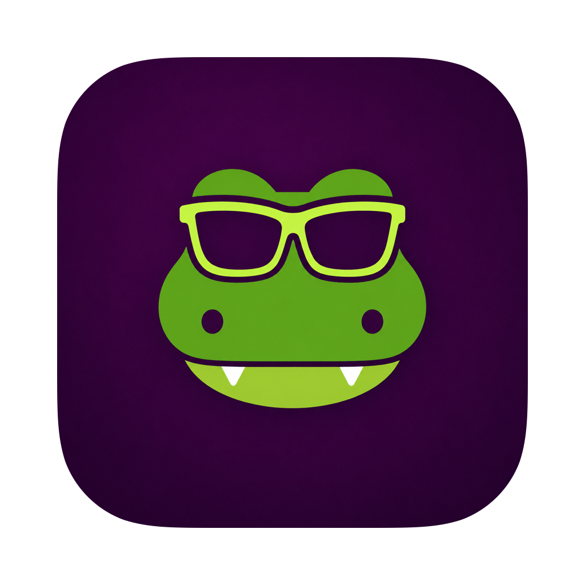
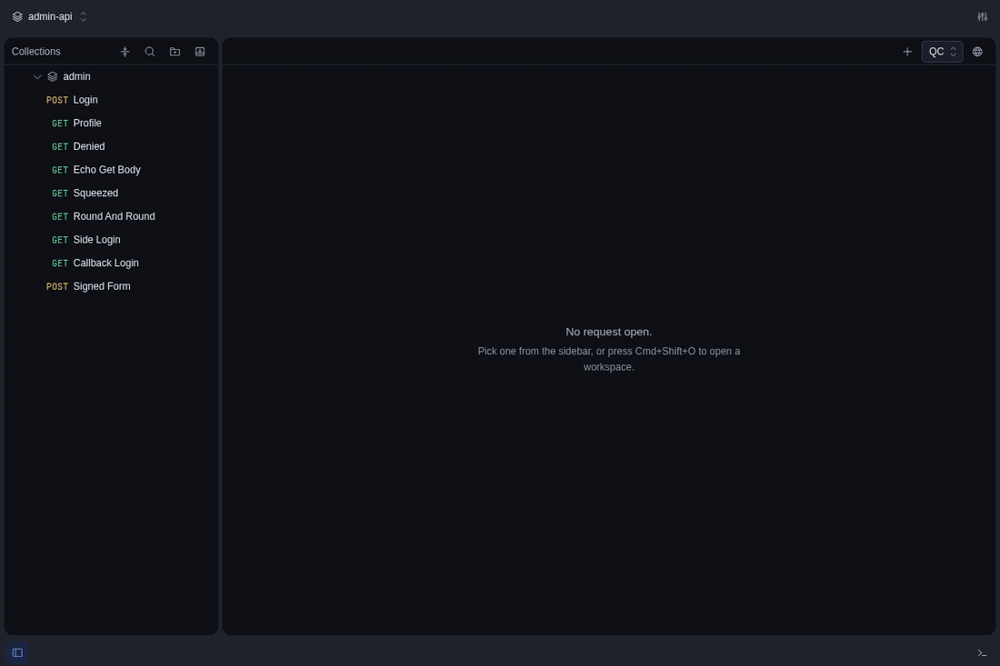
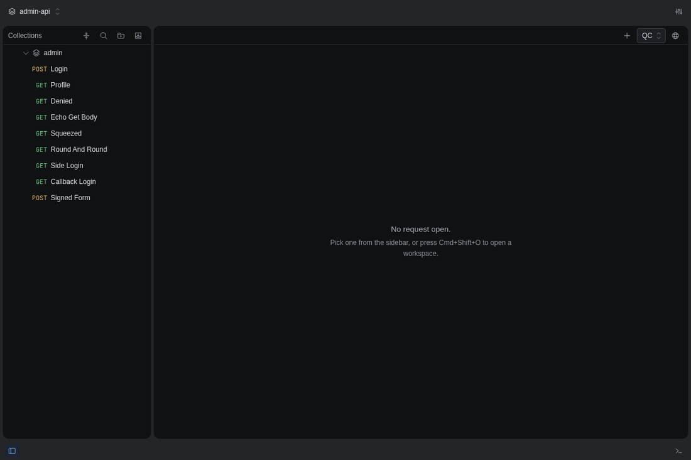
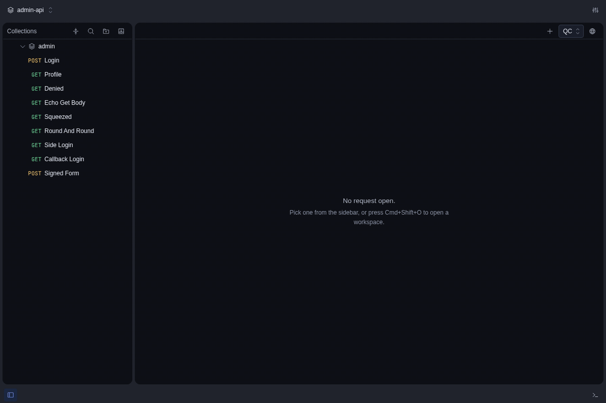

<div align="center">



# preman

**Run a Postman Local View workspace, unary gRPC included, from the terminal or a desktop app**

A CLI and a macOS app that read the `.postman/` and `postman/` files checked into your repository
and run them locally: HTTP and unary gRPC, Postman scripts and tests, environments, and CI reports,
without the paid Postman runner.

[](https://github.com/tranphucbol/preman-cli/releases/latest)
[](https://www.npmjs.com/package/preman)
[](LICENSE)
[](https://www.typescriptlang.org)
[](https://www.electronjs.org)
[](https://github.com/tranphucbol/preman-cli/actions/workflows/ci.yml)

**[Releases](https://github.com/tranphucbol/preman-cli/releases)** ·
**[Documentation](#documentation)** ·
**[Contributing](CONTRIBUTING.md)** ·
**[Report a bug](https://github.com/tranphucbol/preman-cli/issues/new)**

[Why](#why) · [Highlights](#highlights) · [Install](#install) · [Quick start](#quick-start) ·
[How it works](#how-it-works) · [Reference](docs/reference.md) · [License](#license)



</div>

## Why

[Local View and Native Git](https://learning.postman.com/docs/use/native-git/overview/) keep
collections, environments, specs, and tests in the same Git repository as the application code.
Postman Desktop remains a good place to edit them. The free Postman CLI can run HTTP collections,
but [gRPC collection runs require a paid plan](https://learning.postman.com/docs/postman-cli/postman-cli-run-collection/):

```text
$ postman collection run postman/collections/payment
Error: This collection contains gRPC requests. Please upgrade your plan to run collections with gRPC protocol support.
Visit https://www.postman.com/pricing/ for more details.
```

preman reads the checked-in files directly and runs those requests locally. It is a small
alternative runner for Postman's filesystem format, not a replacement for the full Postman CLI.

## Highlights

- [Unary gRPC and HTTP](docs/guide/cli.md#what-runs): a request's `.proto` or embedded descriptor;
  multipart, `urlencoded`, binary and GraphQL bodies; server-sent events.
- [Postman's scripts, as written](docs/reference.md#scripts): pre-request, post-response and
  `onMessage`, `pm.test`, `pm.sendRequest`, and Lodash, CryptoJS, Moment and the other common
  libraries.
- [Made for CI](docs/guide/cli.md#in-ci): JSON and JUnit reports, iteration data, environment
  writeback, and exit codes that tell a transport failure from a failed test.
- [A linter for silent mistakes](docs/guide/lint.md): fields that parse but are never read, found
  without sending a request.
- [Protos that resolve on every machine](docs/guide/protos.md): declared through one shared link per
  repository, with the missing ones named and a one-command repair.
- [Paste a curl or grpcurl](docs/guide/import-and-copy.md#importing-a-pasted-command): it becomes a
  request file, and every flag that could not be kept is named.
- [Copy a request as a command](docs/guide/import-and-copy.md#copying-a-request-as-a-command): the
  `curl` or `grpcurl` that would send it, with what it cannot carry listed.
- [Migrate from Postman cloud](docs/guide/migrate.md): a cloud workspace onto disk, gRPC included,
  borrowing Postman Desktop's session.
- [A desktop app on the same files](docs/guide/desktop.md): edit and run requests in a window; the
  CLI sees every change, and `git status` stays clean.
- [Mutual TLS and private CAs](docs/reference.md#tls-and-certificates): from flags or
  `.postman/preman.yaml`.

In the app, `Cmd+K` opens any request by name, and a script's `pm.environment.set` carries a login
token into the next request:



A pasted `curl` becomes a request file you can send straight away:



## Install

**CLI**: requires Node.js 20 or later.

```sh
npm install -g preman
```

**Desktop app**: download the arm64 DMG from the
[latest release](https://github.com/tranphucbol/preman-cli/releases/latest). Once installed, the app
[updates itself](docs/guide/install.md#updates).

| Platform              | Download                                                                                  |
| :-------------------- | :---------------------------------------------------------------------------------------- |
| macOS (Apple silicon) | [`preman-<version>-arm64.dmg`](https://github.com/tranphucbol/preman-cli/releases/latest) |

The app is ad-hoc signed rather than notarized, so macOS calls the download _damaged_ the first time.
Drag `preman.app` to `/Applications` and clear the quarantine attribute:

```sh
xattr -dr com.apple.quarantine /Applications/preman.app
```

See [Install](docs/guide/install.md) for why, and for building from source.

## Quick start

From a repository connected to Postman Local View:

```sh
preman list
preman run "payment/Long Chau"
```

```text
payment/Long Chau  →  pe.aev2.ExchangeService.Exchange
target localhost:9095 [plaintext] (request url) · schema proto-file

✓ OK / OK 563ms
{
  "return_code": "OK",
  "transaction": { ... }
}

✓ Transaction status is TRANS_PROCESSING
1 test · 1 passed
```

1. `preman` searches upward from the current directory for `.postman/resources.yaml` or a
   `postman/collections` directory; `-d <path>` points it at another repository.
2. `preman run <collection>` runs every request in a collection or folder in Postman order;
   `-e <name>` picks the environment.
3. If a gRPC request cannot find its schema, `preman protos` names the link that is missing.
4. In the app, **Open workspace…** on the same repository shows the same requests.

## How it works

preman is three packages. `@preman/core` is the engine: it discovers the workspace, resolves
variables, runs scripts in a `node:vm` sandbox, and sends the request. The `preman` CLI and
`@preman/desktop` are two front ends to it, and both read and write the same files, so the
workspace on disk is the only state they share. The desktop app runs three kinds of process: the
main process owns the window and holds no workspace state, each open workspace gets its own engine
in an Electron utility process, and the renderer is a pure view that talks to that engine over a
`MessagePort`. Response bodies stay in the engine, and edits are written through the YAML document
API so comments and formatting survive. [The reference](docs/reference.md) describes the behaviour
in full, and [docs/decisions](docs/decisions/README.md) records why it is built this way.

## Documentation

**Using preman**

- [Install](docs/guide/install.md): the CLI, the desktop app, opening the unsigned macOS app,
  updates, and building from source.
- [Running from the terminal](docs/guide/cli.md): commands, options, CI reports, and what runs.
- [Linting](docs/guide/lint.md): finding fields preman will not honour, without sending a request.
- [Protos](docs/guide/protos.md): declaring `.proto` files through a shared link.
- [Importing and copying commands](docs/guide/import-and-copy.md): `curl` and `grpcurl`, in and out.
- [Migrating from Postman cloud](docs/guide/migrate.md): a cloud workspace onto disk.

**The desktop app**

- [The desktop app](docs/guide/desktop.md): workspaces, requests, environments, auth, bodies and
  responses.
- [The log and debugging](docs/guide/diagnostics.md): what the log holds, and attaching an
  inspector to the engine.

**Reference**

- [Reference](docs/reference.md): selection rules, variable precedence, protocol behaviour, scripts,
  assertions, exit codes, schema resolution, and the engine protocol.
- [Decisions](docs/decisions/README.md): the architecture decision records.
- [Performance](docs/performance.md): the budgets the test suite asserts.

## Not supported

- Streaming gRPC (client, server or bidirectional), gRPC server reflection, WebSocket and other
  request kinds; a collection run reports them instead of executing them.
- Intel, universal, Windows and Linux builds of the desktop app.

## Contributing

Bug reports and pull requests are welcome. [CONTRIBUTING.md](CONTRIBUTING.md) covers setting up and
which checks a change needs; [AGENTS.md](AGENTS.md) is the full reference for commands and
conventions.

## License

[MIT](LICENSE)
